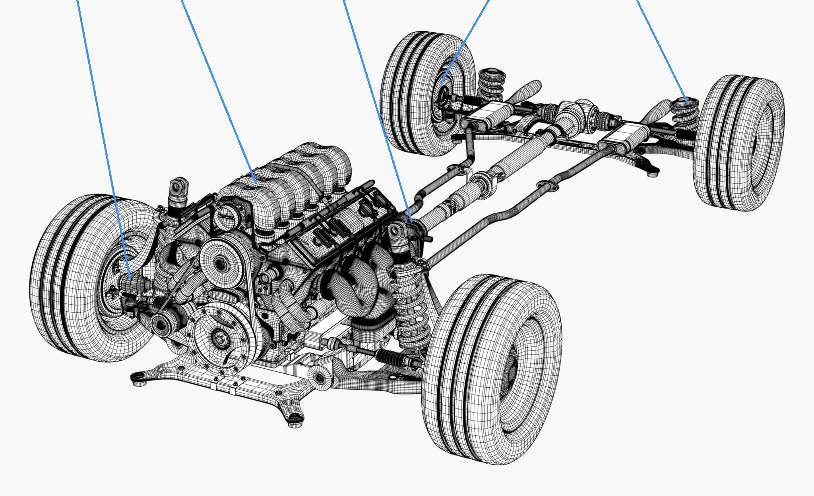

# 차량 내부 시스템

자동차가 제대로 움직이려면 수많은 부품이 각자의 역할을 하며 서로 맞물려 작동해야 한다. 하지만 각 부품이 어떤 일을 하고, 시스템들이 어떻게 연결되는지는 겉으로 잘 드러나지 않는다. 이 라이브러리에서는 내연기관차를 이루는 부품과 기능을 주요 시스템별로 나누어, 자동차의 작동 원리를 이해하기 쉽게 정리한다.

# 목차
[조향 (Steering System)](./steering.md) |
[엔진 (Engine System)](./enginesystem.md) |
[변속기 (Transmission System)](./Transmission-system.md) |
[제동 (Brake System)](./brakes.md) |
[현가장치 (Suspension System)](./suspension.md) 

