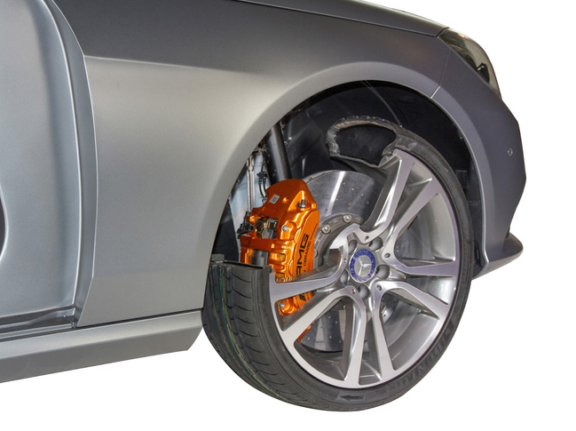
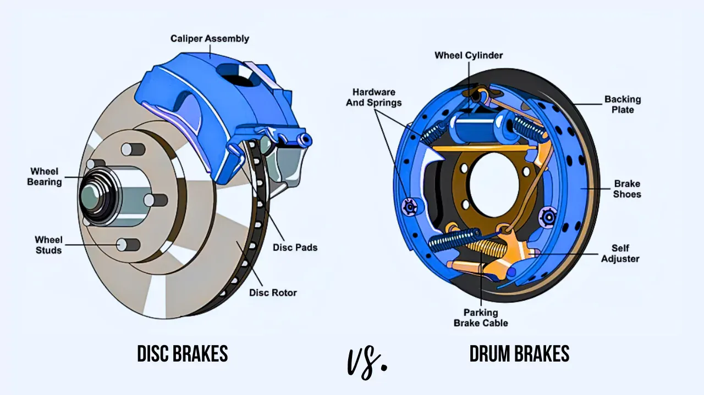
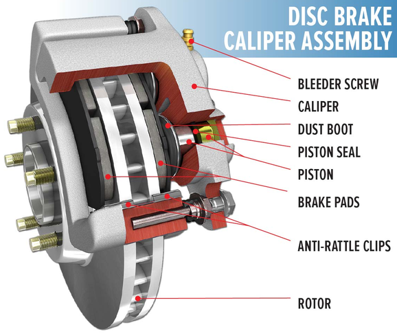
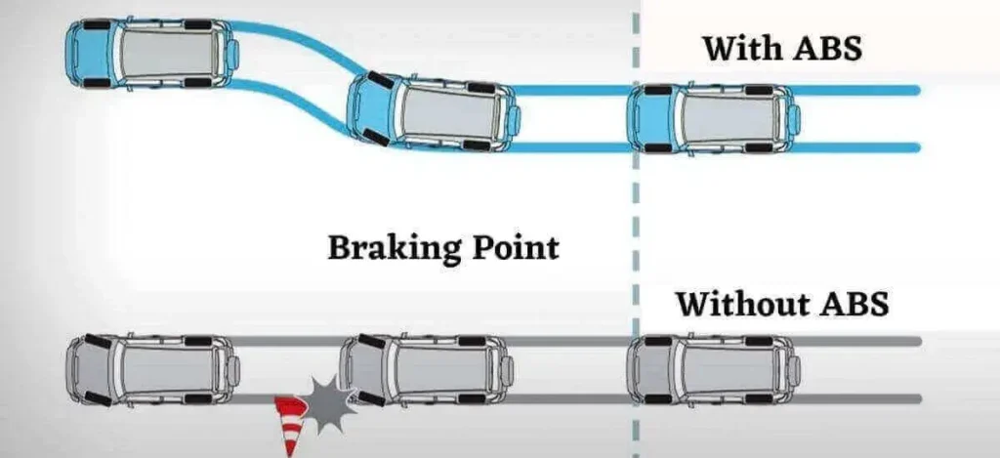

# 브레이크
제동장치(Brake)는 물체의 이동을 늦추거나 물체를 멈추는 장치이다. 자동차, 자전거, 오토바이처럼 바퀴로 움직이는 장비에는 여러 제동 방식이 있는데, 자동차에서 주로 쓰이는 마찰식 제동장치는 바퀴와 함께 회전하는 부품에 마찰력을 가해 바퀴의 회전을 늦춘다.

## 1. 브레이크 원리

승용차의 질량은 1.5톤 남짓이고, 50km/h(13.9m/s)으로 달리는 1.5톤의 자동차를 멈추려면 144,700J 정도의 상당한 에너지가 필요하다. 브레이크는 이 많은 운동에너지를 열에너지로 전환하여 차량을 멈춘다. 브레이크 패드가 디스크에, 또는 슈가 드럼에 접촉하면서 생긴 마찰이 운동에너지를 열에너지로 전환한다. 일반적인 주행중 제동의 열에너지로 인해 온도는 약 140°C 정도로 올라가고, 급제동이나 반복주행 중에는 더 높은 온도에도 도달하기 때문에 브레이크 부품은 잦은 온도 변화를 오랜기간 견딜 수 있는 물질들로 제작된다. 일부 휠은 브레이크 주변의 공기 흐름을 원활하게 해 브레이크의 냉각을 돕기도 한다.

## 2. 브레이크 종류

>브레이크의 마찰을 일으키는 방식으로는 디스크 브레이크와 드럼 브레이크가 있다. 

### 2.1. 디스크(Disc Brake)
디스크 브레이크에서는 바퀴와 함께 회전하는 디스크를 브레이크 패드로 눌러서 마찰을 일으킨다. 브레이크 패드들은 캘리퍼라고 하는 집게를 통해 디스크에 눌린다. 이 마찰로 운동에너지가 열에너지로 전환되고, 디스크의 회전이 느려지면서 차량이 멈춘다. 디스크가 바깥 공기에 노출되어 있어 열을 비교적 빠르게 방출하고, 일부 디스크에는 내부 통로나 환기 구조를 통해 공기 흐름을 증가한다.

>*공기흐름이 향상된 디스크*

**디스크 브레이크의 부품들**

- **브레이크 디스크** — 바퀴와 함께 회전하며 양쪽에 마찰면을 제공한다.
- **브레이크 패드** — 디스크 양쪽 면을 눌러 바퀴를 감속한다.
- **캘리퍼** — 패드를 고정하고 디스크 쪽으로 압착한다.
- **브래킷과 가이드 핀** — 캘리퍼를 지지하고 움직임을 안내한다.
- **브레이크 호스** — 캘리퍼까지 유압을 전달한다.
- **더스트 실드** — 디스크와 주변 부품을 먼지나 이물질로부터 보호한다

---

### 2.2. 드럼(Drum Brake)
드럼 브레이크에서는 바퀴와 함께 회전하는 원통형 드럼 안쪽으로 브레이크 슈가 밀려나와 드럼의 내면과 접촉하여 마찰을 일으킨다. 이 마찰이 바퀴의 회전을 늦추고, 운동에너지를 열에너지로 바꿔 차량을 멈춘다. 드럼의 회전이 슈를 더 강하게 밀어주는 효과가 있어 제동력을 높일 수 있지만, 구조가 닫혀 있어 열이 빠져나가는 속도는 디스크 브레이크보다 느리기 때문에 반복해서 제동하면 열이 쌓여 성능이 떨어지는 단점이 있다. 

**드럼 브레이크의 부품들**

- **브레이크 슈** — 바깥쪽으로 벌어져 드럼 안쪽을 눌러 바퀴를 감속한다.
- **휠 실린더와 피스톤** — 유압을 이용해 브레이크 슈를 바깥쪽으로 밀어낸다.
- **복귀 스프링** — 브레이크를 놓았을 때 슈를 드럼에서 떨어뜨린다.
- **간극 조절 장치** — 마찰재가 마모되어도 슈와 드럼 사이의 간격을 적절하게 유지한다.
- **백킹 플레이트** — 브레이크 부품을 지지한다.
- **주차 브레이크 레버 연결 장치** — 주차할 때 슈를 기계적으로 작동시킨다.

## 3. ABS

ABS는 Anti-lock Braking System, 즉 브레이크 잠김 방지 시스템이다. 브레이크는 차량 자체를 멈추는 것이 아니라 휠을 멈추는 것이기 때문에, 만약 차량이 속도가 빠른 상태에서 휠을 멈춰버리면 관성으로 인해 차량은 계속 나아가게 되고, 노면과 타이어 사이에서의 마찰 한계가 초과되어 차량이 미끄러지면 휠을 통해 차량을 조종할 수 없게 된다. 이 상태를 Lock-up 이라고 부르고, ABS는 이런 사태를 방지하기 위해 제동을 제어하는 시스템이다. ABS는 바퀴 속도 센서가 바퀴가 잠길 듯한 상황을 감지하면 브레이크 압력을 빠르게 조절해 타이어가 계속 구르도록 돕는다.
